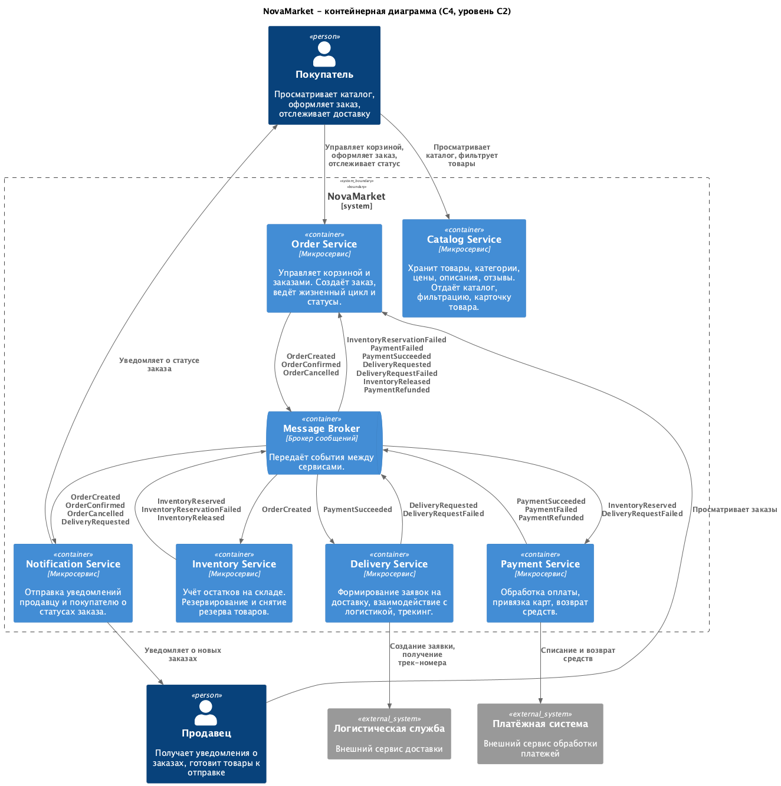
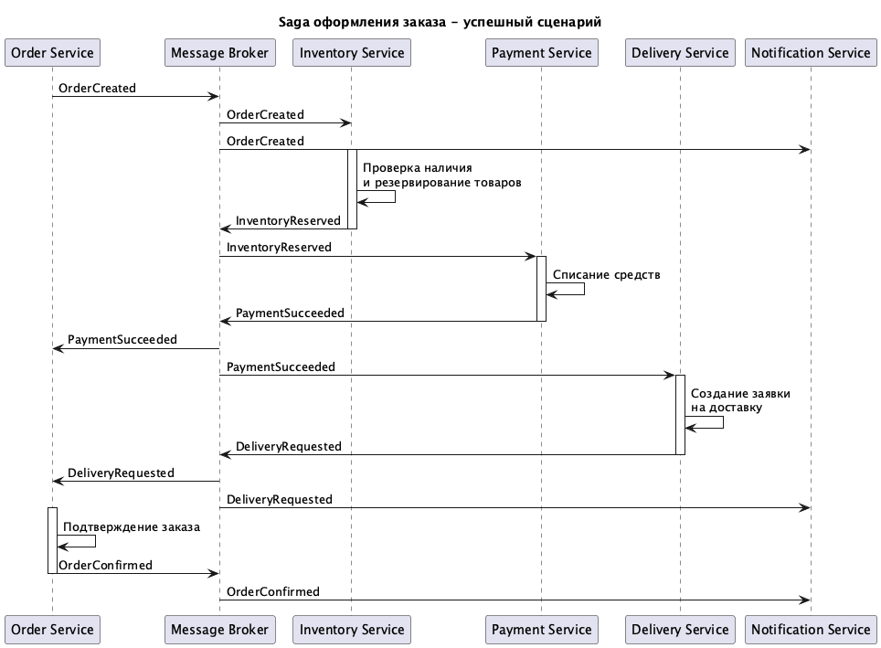
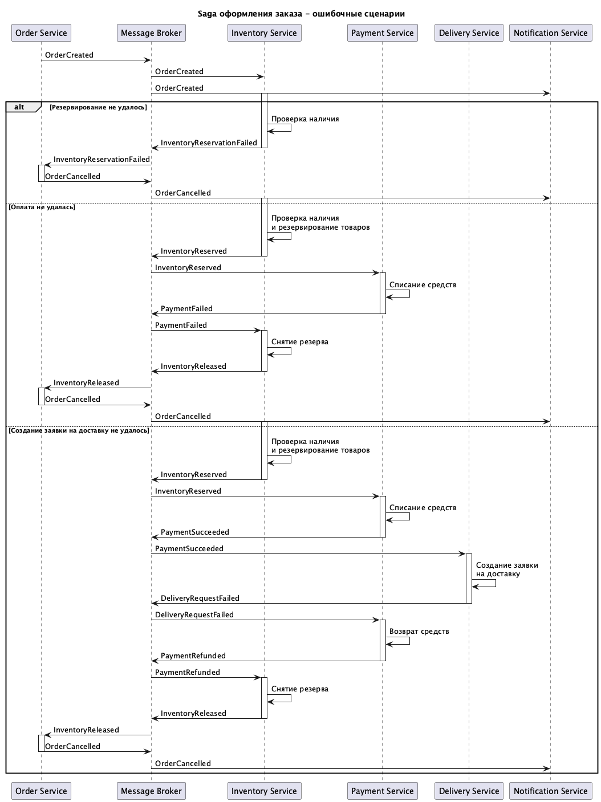

# Задание 1. Проектирование приложения на базе EDA

## Часть 1. Событийная архитектура

Контейнерная диаграмма C4 (уровень C2) описывает 6 микросервисов, брокер сообщений и внешние системы.

## Часть 2. Saga-хореография оформления заказа

### Реестр событий

| Этап | Тип события | Название |
|---|---|---|
| Заказ создан | domain | OrderCreated |
| Товары зарезервированы | domain | InventoryReserved |
| Резервирование не удалось | failure | InventoryReservationFailed |
| Оплата прошла | domain | PaymentSucceeded |
| Оплата не удалась | failure | PaymentFailed |
| Заявка на доставку создана | domain | DeliveryRequested |
| Создание заявки на доставку не удалось | failure | DeliveryRequestFailed |
| Резерв снят | compensation | InventoryReleased |
| Возврат средств | compensation | PaymentRefunded |
| Заказ подтверждён | domain | OrderConfirmed |
| Заказ отменён | compensation | OrderCancelled |

### Успешный сценарий

### Ошибочные сценарии

