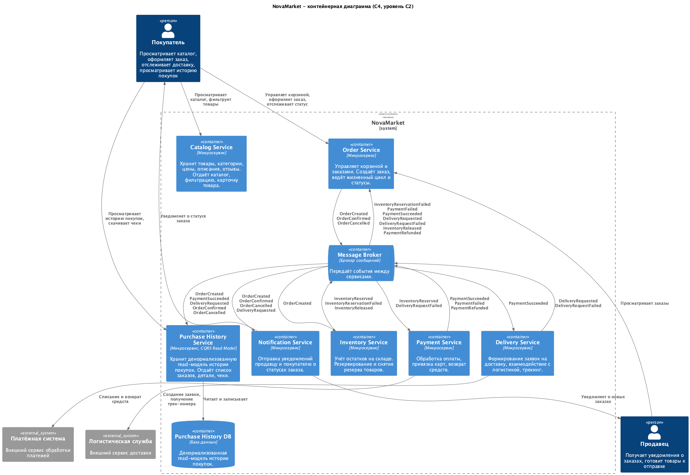

# Задание 2. Агрегированные данные на фронтенде

## Контейнерная диаграмма C4 (уровень C2)

В архитектуру добавлен Purchase History Service. Сервис хранит денормализованную read-модель истории покупок и подписывается на события из брокера.

## ADR

[ADR.md](./ADR.md)