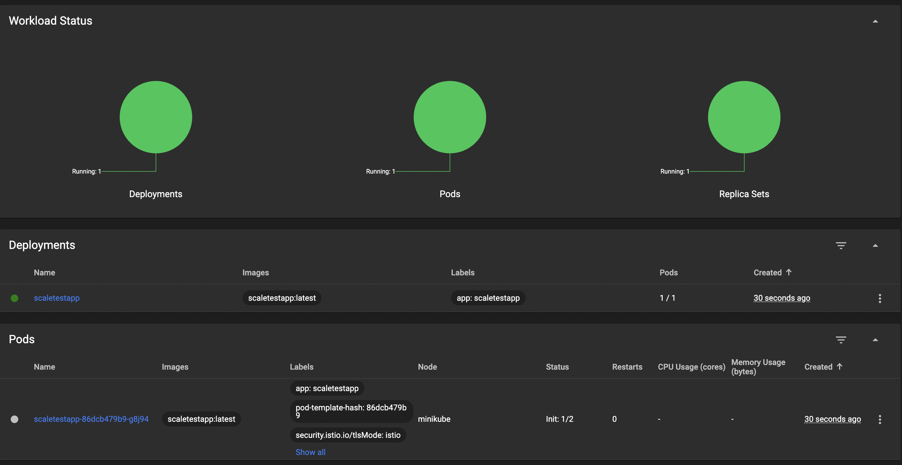
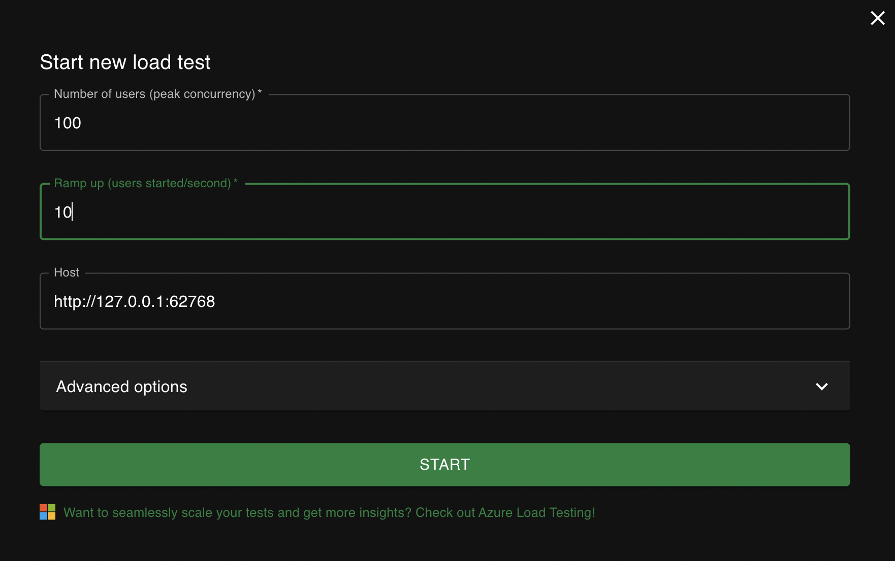
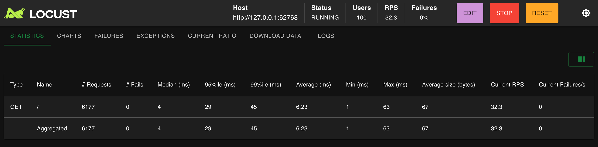
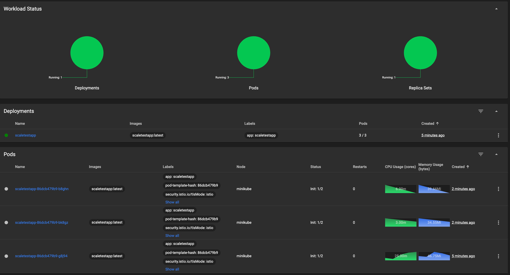

# Задание 3. Динамическое масштабирование в Kubernetes

## Манифесты

- [deployment.yaml](./deployment.yaml) — Deployment тестового приложения. Одна реплика, лимит памяти 30Mi.
- [service.yaml](./service.yaml) — Service типа NodePort для доступа к приложению.
- [hpa.yaml](./hpa.yaml) — HorizontalPodAutoscaler. Целевая утилизация памяти 80%, от 1 до 10 реплик.
- [locustfile.py](./locustfile.py) — сценарий нагрузочного тестирования для Locust.

## Порядок запуска

### 1. Запуск кластера и активация metrics-server

```bash
minikube start
minikube addons enable metrics-server
```

### 2. Применение манифестов

```bash
kubectl apply -f deployment.yaml
kubectl apply -f service.yaml
kubectl apply -f hpa.yaml
```

### 3. Получение URL приложения

```bash
minikube service scaletestapp --url
```

Команда выведет URL вида `http://192.168.49.2:XXXXX`.

### 4. Запуск нагрузочного теста

```bash
cd task3
locust
```

Открыть http://localhost:8089 в браузере. В поле "Host" указать URL из шага 3. Задать количество пользователей и скорость их создания, запустить тест.

### 5. Проверка масштабирования

В отдельном терминале выполнить:

```bash
kubectl get hpa scaletestapp --watch
```

Команда покажет текущую утилизацию памяти и количество реплик в реальном времени.

Для получения скриншотов открыть дашборд:

```bash
minikube dashboard
```

## Результаты

Состояние до нагрузочного теста (1 реплика):



Настройки Locust:



Locust во время теста:



Состояние после нагрузочного теста (HPA увеличил количество реплик):


